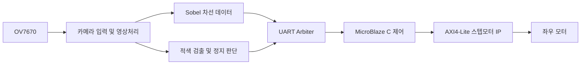

# 영상처리와 모터 제어 구조

## 담당 범위

AXI4-Lite 스텝모터 IP, Red Detection 1차 통합, 차선 데이터 기반 방향 판단과 UART 연동입니다. 카메라·Sobel 경로 등 팀 통합 코드를 함께 보존했으며 전체 시스템을 단독 설계했다는 의미는 아닙니다.

## 핵심 설계

- `microblaze/`에는 스텝모터·UART 커스텀 IP와 MicroBlaze BD/XSA가 있습니다.
- `firmware/vitis_code/`는 HAL·드라이버·애플리케이션의 원래 폴더 구성을 유지합니다.
- `fpga/red_detection/`에는 적색 분류, 노이즈 처리, ROI 및 정지 판단 모듈이 있습니다.
- `fpga/intergration/uart_arbiter.v`는 원본 철자의 폴더명을 유지합니다.

차선 좌표와 정지 명령은 같은 UART 채널을 사용하며, 정지 명령을 좌표와 구분하여 처리합니다. 이동평균을 통한 방향 제어와 정지 명령 우선 처리가 핵심 통합 지점입니다.

## 검증 자료의 구분

`sobel_filter_uvm_verification/`은 제출본에 동봉된 Sobel 단독 검증 환경입니다. 전체 차량 통합 검증과 범위를 구분하며, 해당 환경 전체의 작성자를 이 README에서 새로 지정하지 않습니다.
